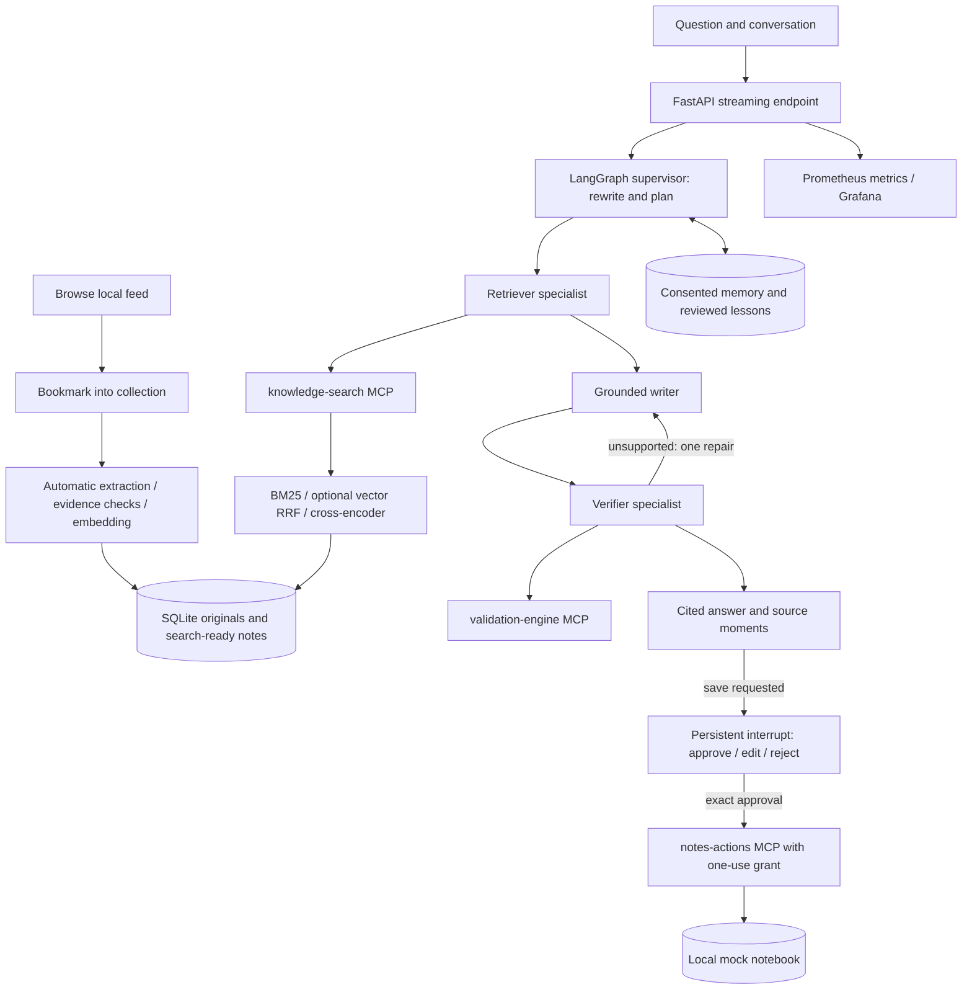

# Gather request walkthrough

1. The user browses a local video/photo feed. Browsing and adding an upload to the feed make no AI calls. Bookmarking into a collection explicitly authorizes preparation of that selected source. The original is retained locally.
2. A single bounded background worker extracts evidence-linked notes, validates references and creates the embedding automatically. Only successful completion marks a new save Search ready. AI-generated notes are explicitly distinguished from human-reviewed legacy notes. Embedding retries reuse retained extraction; re-saving to another collection reuses the same job/vector. Extraction runs outside the chat graph; restart requires retry with the key again, not a claim of resumable ingestion. Exact-payload approval is retained for agent notebook writes, not imposed on internal private indexing.
3. A question enters FastAPI with bounded input, origin checks and credentials in request-only context. The graph supervisor resolves follow-up references with a model when available. It emits a visible, model-generated plan constrained to retrieval, writing and verification roles. Comparison queries can produce two retrieval queries. In no-key mode the query is used as supplied.
4. The retriever uses MCP to find approved evidence passages after topic/collection/saved-date filtering. BM25 is local. Semantic mode uses stored note vectors and query embedding with RRF; Qdrant can run locally or via Compose. Cross-encoder reranking is enabled when `RERANK_MODEL` and its dependency/weights are available. Missing capabilities emit warnings. Cosine similarity ranks candidates; the selected generative model then checks conceptual relevance against the source text. Every positive decision includes an exact supporting quote. This permits broader category and paraphrase matches without query-word overlap. The small cross-encoder only orders already validated results and cannot veto them through its earlier zero-logit gate. If the generative check fails, the app explicitly labels keyword fallback. Explicit keyword topics are required together rather than matched with a broad OR.
5. The writer returns individual claims citing passage IDs; without a model it returns source excerpts. It may compare sources only when retrieved evidence permits it.
6. The verifier checks citation membership using a second MCP server, and model-checks paraphrase support when a model is connected. Failed support triggers one revision. Unresolved claims are omitted. This is a fallible checker, not a guarantee.
7. The answer links to source media; valid reported timestamps can seek playback. Timestamp estimates are not aligned-ASR measurements. Live captions/audio/OCR are obtained by the existing model extraction, not separate dedicated recognition systems.
8. If the user requested a notebook note, `interrupt()` pauses with the exact payload and fingerprint. Persistent SQLite checkpoints support stop/resume. Edits loop back to a new review; approval creates an in-memory one-use grant; publishing rechecks source versions. The standalone HTTP write server cannot mint grants; the API invokes the same FastMCP action server in process.
9. Agent traces include prompt version, model/provider, tool calls and reported usage. Prometheus exposes counts/latencies and Grafana provisioning includes a dashboard. Alerts are configured for failed runs and unavailable scraping. A running Docker service is needed to verify the full deployment/alert demo.

The team path uses a model supervisor, retrieval specialist, writer and verifier. The supervisor generates a constrained plan and query decomposition. The retriever observes search results and may refine once; the writer may inspect one supplied passage before synthesis; the verifier observes the deterministic checker and judges paraphrase support, triggering at most one repair. These bounded tool-observation loops keep costs predictable. The graph defines allowed transitions, so the planner cannot invent capabilities or bypass approval. The single-agent baseline chooses read tools in a bounded ReAct loop using the same model, corpus and limits.

The app remains a supervised local prototype; it does not connect to Instagram, scrape collections, publish to social networks or edit Notion. The mock notebook demonstrates approved write actions without external account access.
